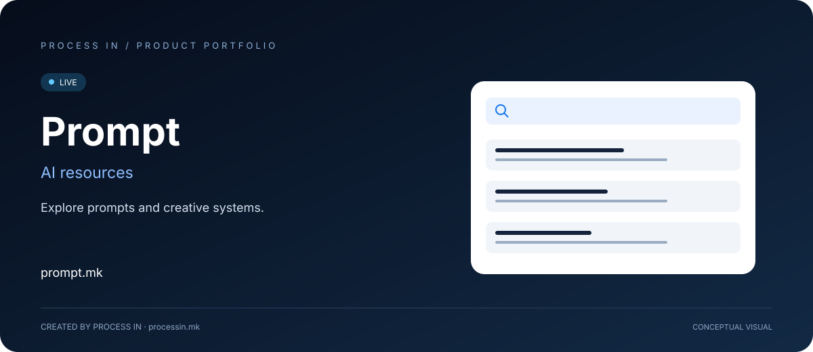

# Prompt

**Истражи промптови и креативни системи.**

[Македонски](README.mk.md) · [English](README.md) · [Shqip](README.sq.md) · [Türkçe](README.tr.md)

**LIVE**

## Пронајди AI ресурс според задачата и моделот.

AI промптот е корисен во контекст: каков резултат треба да даде, за кој модел е наменет и како се вклопува во задачата. Ресурс за слики има различна намена од текстуален промпт или агентска вештина.

Prompt претставува маркетплејс и заедница организирани околу овие разлики. Страницата за истражување го стеснува изборот по тип ресурс, модел, категорија, цена и оценка.

## Како да започнеш

| Чекор | Постапка |
|---|---|
| 01 | Отвори Истражи |
| 02 | Избери тип ресурс |
| 03 | Избери модел и категорија |
| 04 | Прегледај достапни резултати |

## Главни можности

| Област | Што овозможува |
|---|---|
| **Типови ресурси** | Текст, слики, видео, аудио и агентски вештини. |
| **Модели** | Избор според AI модел. |
| **Категории** | Креативни и професионални теми. |
| **Цена** | Бесплатни и платени ресурси. |
| **Оценки** | Избор по минимална оценка. |
| **Истражување** | Комбинирање на достапните филтри. |

## Кому му помага и за што

| Корисник | Практична примена |
|---|---|
| **Креативни AI корисници** | Разгледуваат ресурси за слики, видео, аудио и креативни теми. |
| **Професионалци** | Бараат ресурси за пишување, маркетинг, програмирање, продуктивност или бизнис. |
| **Корисници на агентски вештини** | Ги користат филтрите за тип и модел за насочено истражување. |

## Конкретни ситуации на користење

### Подготовка на креативна задача

Избери излезен формат и модел, па стесни категорија пред преглед на понуди.

### Споредба на бесплатни и платени ресурси

Користи цена и оценка заедно со намената на ресурсот и моделот.

## Зошто да го разгледаш решението

Организацијата на изборот помага ресурсот да одговара на намената. Моделот, типот и темата се практични критериуми. Достапните понуди го одредуваат актуелниот избор; категориите сами по себе не се број на ресурси.

## Официјални информации

| Податок | Вредност |
|---|---|
| Веб-страница | [prompt.mk](https://prompt.mk/) |
| Категорија | AI ресурси |
| Статус | LIVE |
| Развој | [PROCESS IN](https://processin.mk) |
| Контакт за портфолиото | [contact@processin.mk](mailto:contact@processin.mk) |

Извори за презентацијата: [1](https://prompt.mk/explore).

### [Посети Prompt](https://prompt.mk/)

[PROCESS IN — Your Enterprise Software & AI Partner](https://processin.mk)

---

Јавна презентација на производ. Без приватен изворен код или кориснички податоци.

This platform is a digital product of <a href="https://processin.mk" target="_blank">PROCESS IN</a> · Your Enterprise Software & AI Partner ·  
Hosted on Enterprise Infrastructure by <a href="https://inhost.mk" target="_blank">INHOST</a> ·
